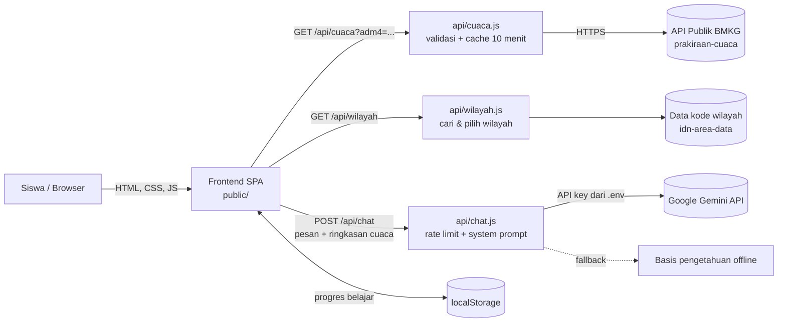

# BanjirEuy 🌧️

**Website edukasi interaktif kesiapsiagaan banjir untuk siswa SMA/SMK/Sederajat**, dilengkapi chatbot AI "Kak Euy" dan dashboard cuaca live dari API publik BMKG.

> Logicodix 2026 · Hackathon Competition · Kategori **Web**
> Subtema: **Smart & Fun Education** (dengan dukungan *Civic Tech & Community Service*)

---

## 👥 Tim

| Nama | Program Studi | Akun GitHub |
|---|---|---|
| Anceli Anggi Putri Br Sidabalok | Meteorologi, ITB | anggiancely-droid |
| Bulan Ayu Azzahra | Meteorologi, ITB | bulanazzahrasn-afk |
| Arzhella Alvyana Alcaf | Meteorologi, ITB | arzhellaalyanaalcaf-byte |
| Yuriko Zulaikha Alhaz | Meteorologi, ITB | yurikoalhaz-07 |

---

> ℹ️ **Catatan Proses Kerja Kelompok & Riwayat Commit GitHub:**  
> Seluruh proses perancangan, koding, pengujian, dan penyusunan berkas proyek **Banjir Euy** dikerjakan secara kolaboratif bersama oleh seluruh 4 anggota tim. Pengerjaan teknis dilakukan secara tatap muka dengan berbagi **2 perangkat laptop (device)**, sehingga riwayat *commit* dan *push* di repositori GitHub ini sebagian besar terakumulasi dan terekam melalui akun `@arzhellaalyanaalcaf-byte` dan `@anggiancely-droid`. Meskipun demikian, seluruh ide, fitur, materi, dan berkas submission merupakan hasil kontribusi aktif dari keempat anggota tim.

---

## 🛠️ Kontribusi Masing-Masing Anggota Tim

* **Anceli Anggi Putri Br Sidabalok (`@anggiancely-droid`)**
  * **Pengembangan & Integrasi AI/API:** Mengembangkan fungsi server lokal, integrasi API cuaca real-time BMKG, dan asistensi AI/Chatbot interaktif untuk edukasi kesiapsiagaan banjir.
  * **Dokumentasi & Arsitektur:** Menyusun `README.md`, diagram alur arsitektur sistem, variabel lingkungan (`.env.example`), serta panduan instalasi lokal.
  * **Kolaborasi Tim:** Merekam dan menyelaraskan alur penggunaan fitur utama pada aplikasi untuk keperluan demonstrasi produk.

* **Arzhella Alvyana Alcaf (`@arzhellaalyanaalcaf-byte`)**
  * **Frontend & UI/UX:** Merancang fondasi antarmuka (*dashboard*) berbasis web, tata letak visual 3D, dan struktur awal repositori GitHub.
  * **Manajemen Repository & Deployment:** Mengelola struktur repositori proyek, konfigurasi *code freeze*, serta pengujian *localhost verification*.
  * **Kolaborasi Tim:** Mengkoordinasikan integrasi kode antar-modul di komputer utama pengerjaan tim.

* **Bulan Ayu Azzahra (`@bulanazzahrasn-afk`)**
  * **Produksi Video Demo (3-5 Menit):** Bertanggung jawab atas perekaman, alur demonstrasi visual aplikasi berjalan, dan penyuntingan video demo sesuai ketentuan durasi resmi (3–5 menit).
  * **Edukasi & Konten Interaktif:** Menyusun materi edukasi kesiapsiagaan bencana banjir yang disesuaikan untuk target pengguna siswa SMA.
  * **Pengujian Antarmuka:** Melakukan pengujian alur penggunaan (*user flow*) dan validasi responsivitas tampilan antarmuka.

* **Yuriko Zulaikha Alhaz (`@yurikoalhaz-07`)**
  * **Berkas Administrasi & Legalitas:** Menyusun Dokumen Surat Pernyataan Orisinalitas Karya bertanda tangan dan ber-e-meterai Rp10.000 sesuai format resmi panitia.
  * **Riset Mitigasi & Data:** Melakukan riset dan verifikasi data batas kerentanan banjir serta materi edukasi kesiapsiagaan bencana.
  * **Skenario Demonstration & Quality Control:** Menyusun naskah peragaan fitur utama untuk video demo dan memvalidasi kelengkapan seluruh tautan submission.


## 🧭 Deskripsi Solusi

**Masalah.** Banjir termasuk bencana yang paling sering terjadi di Indonesia, dan sekolah ikut terdampak: kegiatan belajar terhenti, siswa berisiko saat pulang melewati genangan, dan banyak siswa belum tahu harus berbuat apa. Di sisi lain, informasi cuaca resmi BMKG sebenarnya tersedia hingga tingkat kelurahan, tetapi jarang dibaca dan dipahami oleh pelajar.

**Solusi.** BanjirEuy mengemas edukasi kesiapsiagaan banjir menjadi alur belajar singkat yang menyenangkan — **Pahami → Siapkan → Latihan → Uji Diri → Beraksi** — lalu menghubungkannya dengan **data cuaca nyata dari BMKG**, sehingga siswa belajar membaca prakiraan cuaca dan mengambil keputusan yang aman.

**Target pengguna.** Siswa SMA/SMK/Sederajat (usia 15–18 tahun), terutama yang tinggal atau bersekolah di wilayah rawan banjir.

## ✨ Fitur Utama (sudah diimplementasikan)

| Fitur | Keterangan |
|---|---|
| **Landing page** | Hero beranimasi (hujan, awan, gelombang air, kilat), alur belajar, cuplikan cuaca live. |
| **Beranda siswa** | Sapaan personal, progres belajar, kartu fitur, *Info Hari Ini* otomatis dari data BMKG, lencana. |
| **Edukasi** | 7 materi: Apa Itu Banjir, Penyebab, Dampak, Sebelum, Saat, Setelah, Membaca Info Cuaca — dengan ilustrasi & "Tahukah Kamu?". |
| **Starter Pack** | Checklist 14 barang tas siaga yang tersimpan otomatis + **unduh PDF** (dibuat di browser, tanpa library). |
| **Simulasi** | 5 skenario banjir di sekolah dengan adegan beranimasi, umpan balik & alasan tiap pilihan. |
| **Kuis** | 10 soal dengan pembahasan langsung, skor tersimpan. |
| **Hasil & Pencapaian** | Skor, konfeti, statistik, pembahasan jawaban, dan 6 lencana gamifikasi. |
| **Aksi Nyata** | Ajakan menerapkan di sekolah, rencana bertahap, dan janji siswa siaga banjir. |
| **Pilih lokasi seluruh Indonesia** | Cari kelurahan/desa berdasarkan nama, atau pilih bertingkat Provinsi → Kab/Kota → Kecamatan → Kelurahan/Desa (±84 ribu kelurahan/desa). Pilihan tersimpan di browser. Website tidak meminta izin GPS. |
| **Dashboard Cuaca BMKG** | Kondisi terkini, indikator kewaspadaan (gauge), prakiraan per 3 jam (grafik suhu & curah hujan + tooltip), prakiraan harian, pilihan lokasi / kode wilayah adm4. |
| **Chatbot AI "Kak Euy"** | Tanya jawab seputar banjir & cuaca. Menerima konteks cuaca BMKG yang sedang dilihat pengguna. Ada mode offline bila kunci API kosong/kuota habis. |
| **Notifikasi** | Ringkasan cuaca hari ini & besok serta pengingat progres belajar. |
| **Responsif & aksesibel** | Desktop–mobile, dukungan `prefers-reduced-motion`, navigasi keyboard. |

## 🛠️ Teknologi

| Lapisan | Teknologi |
|---|---|
| Frontend | HTML5, CSS3 (custom design system), JavaScript ES Modules — **tanpa framework & tanpa build step** |
| Ilustrasi | SVG buatan tim (sekolah, awan, hujan, gelombang, ikon cuaca beranimasi), animasi CSS & Canvas (konfeti) |
| Backend | Node.js ≥ 18 (modul bawaan `http`, `fetch`) — **tanpa dependensi npm** |
| API pihak ketiga | [API Prakiraan Cuaca Publik BMKG](https://data.bmkg.go.id/prakiraan-cuaca/), [Google Gemini API](https://ai.google.dev/) (atau penyedia OpenAI-compatible) |
| Penyimpanan | `localStorage` (progres belajar, di perangkat pengguna saja) |
| Font | [Plus Jakarta Sans](https://fonts.google.com/specimen/Plus+Jakarta+Sans) (Google Fonts, OFL) |
| Deploy | Vercel (folder `api/` otomatis jadi serverless function, `public/` sebagai situs statis) |

## 🏗️ Arsitektur Sistem & Alur Data



1. Browser memuat SPA dari `public/` (routing berbasis hash `#/beranda`, `#/cuaca`, dst.).
2. Untuk cuaca, frontend memanggil `/api/cuaca`. Server memvalidasi kode wilayah, mengambil data BMKG, merapikannya (kondisi terkini, per 3 jam, ringkasan harian, kategori hujan) dan menyimpannya di cache 10 menit agar tidak membebani server BMKG.
3. Untuk chatbot, frontend mengirim riwayat pesan + ringkasan cuaca ke `/api/chat`. Server menambahkan *system prompt* keselamatan dan meneruskan ke Gemini. **Kunci API tidak pernah dikirim ke browser.**
4. Lokasi cuaca dipilih sendiri oleh pengguna lewat pencarian atau pilihan bertingkat (`/api/wilayah`). Website tidak memakai GPS, jadi tidak ada data posisi pengguna yang dikirim ke server.
5. Progres belajar disimpan di `localStorage` — tidak ada data pribadi yang dikirim ke server.

## 🚀 Instalasi & Menjalankan

**Prasyarat:** [Node.js](https://nodejs.org/) versi 18 atau lebih baru.

```bash
# 1. Masuk ke folder proyek
cd banjireuy

# 2. Salin template environment, lalu isi GEMINI_API_KEY
cp .env.example .env        # Windows: copy .env.example .env

# 3. Jalankan (tidak perlu npm install — tanpa dependensi)
npm start

# 4. Buka di browser
#    http://localhost:3000
```

> ⚠️ Jangan buka `public/index.html` langsung dengan klik ganda. Website perlu dijalankan lewat server (`npm start`) agar fitur cuaca BMKG dan chatbot berfungsi.

### Variabel Lingkungan (`.env.example`)

| Variabel | Wajib | Keterangan |
|---|---|---|
| `PORT` | Tidak | Port server lokal (default `3000`) |
| `GEMINI_API_KEY` | Disarankan | Kunci API Google Gemini (gratis di [Google AI Studio](https://aistudio.google.com/apikey)) |
| `GEMINI_MODEL` | Tidak | Default `gemini-flash-lite-latest` (tercepat); bisa diganti `gemini-flash-latest`. Bila model tidak tersedia, otomatis mencoba model Flash lain |
| `OPENAI_API_KEY` | Tidak | Alternatif: penyedia OpenAI-compatible (Groq/OpenRouter/OpenAI), dipakai jika Gemini kosong |
| `OPENAI_BASE_URL` | Tidak | Contoh: `https://api.groq.com/openai/v1` |
| `OPENAI_MODEL` | Tidak | Nama model penyedia tersebut |

Tanpa kunci API, chatbot tetap berjalan dalam **mode offline** (ditandai jelas di UI).

### Deploy ke Vercel

1. Push repositori ke GitHub (pastikan `.env` **tidak** ikut — sudah ada di `.gitignore`).
2. Di Vercel: *Add New Project* → impor repositori → *Framework Preset*: **Other**, *Output Directory*: **public**.
3. Tambahkan `GEMINI_API_KEY` di *Settings → Environment Variables*, lalu *Deploy*.

## 🔐 Akun Demonstrasi

Tidak memerlukan akun/login. Tombol **Masuk** hanya meminta nama panggilan (opsional) yang disimpan di perangkat pengguna.

## 🤖 Dokumentasi Penggunaan AI

| Layanan / model | Dipakai untuk | Bagian produk |
|---|---|---|
| Google Gemini API (`gemini-flash-lite-latest`, streaming) | Menjawab pertanyaan siswa seputar banjir, kesiapsiagaan, dan interpretasi data cuaca BMKG | Chatbot "Kak Euy" (`api/chat.js`) |
| AI coding assistant | _Tim wajib menuliskan di sini asisten AI yang dipakai saat pengembangan (misalnya Claude dari Anthropic), beserta bagian kode yang dibantu_ | _isi sesuai kenyataan_ |

**Etika & keamanan AI yang diterapkan:**
- *System prompt* mewajibkan AI mengutamakan keselamatan, mengarahkan ke nomor darurat (112/115/117), tidak mengarang data cuaca, dan menyebut BMKG sebagai sumber.
- Rate limit 12 pesan/menit/IP dan batas panjang pesan untuk menjaga kuota & mencegah penyalahgunaan.
- Kunci API hanya di server (environment variable), tidak di-*hardcode* dan tidak dikirim ke browser.
- Tidak ada data pribadi yang dikumpulkan; riwayat chat hanya di `sessionStorage` browser.
- Disclaimer di UI: jawaban AI bisa keliru, ikuti arahan guru/petugas dalam keadaan darurat.

## 📚 Atribusi Sumber

- **Data cuaca:** BMKG (Badan Meteorologi, Klimatologi, dan Geofisika) — [data.bmkg.go.id/prakiraan-cuaca](https://data.bmkg.go.id/prakiraan-cuaca/). Sumber data dicantumkan di setiap tampilan cuaca sesuai ketentuan penggunaan data BMKG.
- **Kode wilayah Kemendagri:** [idn-area-data](https://github.com/fityannugroho/idn-area-data) (data di bawah Open Database License).
- **Kategori intensitas hujan:** klasifikasi curah hujan harian BMKG.
- **Konten edukasi:** dirangkum dari panduan kesiapsiagaan bencana BNPB, informasi BMKG, dan program Satuan Pendidikan Aman Bencana (SPAB).
- **Foto jenis banjir** (dimuat langsung dari Wikimedia Commons; bila gagal dimuat, otomatis diganti ilustrasi SVG):
  - Genangan: [VOA People walk through Jakarta's flooded streets](https://commons.wikimedia.org/wiki/File:VOA_People_walk_through_Jakarta%27s_flooded_streets.jpg), VOA Indonesian Service, domain publik.
  - Luapan sungai: [Flood in Tanah Laut Regency](https://commons.wikimedia.org/wiki/File:Flood_in_Tanah_Laut_Regency.jpg), BNPB, domain publik.
  - Bandang: [Banjir Bandang Luwu 2020](https://commons.wikimedia.org/wiki/File:Banjir_Bandang_Luwu_2020.png), BNPB, domain publik.
  - Rob: [Rumah Mak Jah di Desa Bedono yang Tenggelam karena abrasi](https://commons.wikimedia.org/wiki/File:Rumah_Mak_Jah_di_Desa_Bedono_yang_Tenggelam_karena_abrasi.jpg), Tim LindungiHutan, [CC BY 4.0](https://creativecommons.org/licenses/by/4.0/).
- **Ilustrasi karakter siswa & tas** (`public/assets/img/`): _isi sumber/lisensi aset ilustrasi yang dipakai tim_.
- **Ilustrasi vektor lain** (sekolah, awan, hujan, ikon cuaca, ikon fitur): dibuat oleh tim dalam bentuk SVG.
- **Font:** Plus Jakarta Sans — SIL Open Font License.

## 📁 Struktur Folder

```
banjireuy/
├── api/                 # Endpoint serverless (dipakai server lokal & Vercel)
│   ├── cuaca.js         # Proxy + normalisasi data BMKG
│   ├── chat.js          # Proxy chatbot AI (Gemini / OpenAI-compatible)
│   ├── wilayah.js       # Daftar & pencarian wilayah seluruh Indonesia
│   ├── _wilayah.js      # Pemuat dataset kode wilayah Kemendagri
│   ├── status.js        # Info penyedia AI aktif
│   ├── _offline.js      # Basis pengetahuan mode offline
│   └── _util.js         # Helper (JSON, rate limit)
├── public/
│   ├── index.html
│   ├── css/style.css    # Design system & seluruh gaya
│   ├── assets/img/      # Ilustrasi siswa, tas, favicon
│   └── js/
│       ├── app.js       # Router, navbar, inisialisasi
│       ├── store.js     # Progres (localStorage)
│       ├── weather.js   # Layanan & interpretasi cuaca
│       ├── ui.js        # Helper UI (modal, toast, hujan)
│       ├── data/content.js        # Materi, simulasi, kuis, checklist
│       ├── components/  # icons, illus (SVG), chatbot, pdf, confetti
│       └── pages/       # landing, beranda, edukasi, starter, simulasi, kuis, hasil, aksi, cuaca
├── server.js            # Server lokal tanpa dependensi
├── .env.example
└── package.json
```


