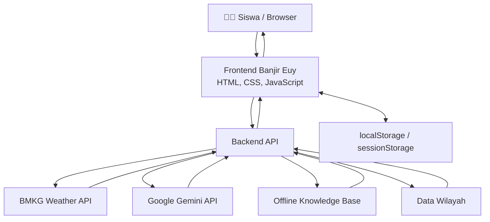

# 🌧️ BANJIR EUY
### Kenali Risikonya, Siapkan Dirimu, Hadapi dengan Ilmu!

<p align="center">
  
  
  
</p>

<p align="center">
  <b>Platform edukasi interaktif kesiapsiagaan banjir untuk siswa SMA/SMK/sederajat.</b>
  <br/>
  Belajar kebencanaan jadi lebih seru melalui materi interaktif, simulasi, kuis, informasi cuaca BMKG, dan chatbot AI.
</p>

---

## 💜 Mengenal Banjir Euy

Banjir Euy adalah platform edukasi berbasis web yang dirancang untuk membantu siswa SMA/SMK/sederajat memahami risiko banjir dan meningkatkan kesiapsiagaan dalam menghadapi bencana.

Melalui pendekatan *Smart & Fun Education*, Banjir Euy menggabungkan pembelajaran kebencanaan dengan teknologi digital agar informasi yang kompleks dapat dipahami secara lebih mudah, menarik, dan interaktif.

**Banjir Euy mengajak siswa melalui lima tahapan pembelajaran:**

<p align="center">
  <b>🧠 PAHAMI</b> → <b>🎒 SIAPKAN</b> → <b>🎮 LATIHAN</b> → <b>🏆 UJI DIRI</b> → <b>🌱 BERAKSI</b>
</p>

## 👥 Tim Pengembang

**Nama Tim: Gass Aja**

| Anggota | Program Studi | GitHub |
|---|---|---|
| Anceli Anggi Putri Br Sidabalok | Meteorologi — ITB | [@anggiancely-droid](https://github.com/anggiancely-droid) |
| Bulan Ayu Azzahra | Meteorologi — ITB | [@bulanazzahrasn-afk](https://github.com/bulanazzahrasn-afk) |
| Arzhella Alvyana Alcaf | Meteorologi — ITB | [@arzhellaalyanaalcaf-byte](https://github.com/arzhellaalyanaalcaf-byte) |
| Yuriko Zulaikha Alhaz | Meteorologi — ITB | [@yurikoalhaz-07](https://github.com/yurikoalhaz-07) |


> ℹ️ **Catatan Proses Kerja Kelompok & Riwayat Commit GitHub:**  
> Seluruh proses perancangan, koding, pengujian, dan penyusunan berkas proyek **Banjir Euy** dikerjakan secara kolaboratif bersama oleh seluruh 4 anggota tim. Pengerjaan teknis dilakukan secara tatap muka dengan berbagi **2 perangkat laptop (device)**, sehingga riwayat *commit* dan *push* di repositori GitHub ini sebagian besar terakumulasi dan terekam melalui akun `@arzhellaalyanaalcaf-byte` dan `@anggiancely-droid`. Meskipun demikian, seluruh ide, fitur, materi, dan berkas submission merupakan hasil kontribusi aktif dari keempat anggota tim.

---

### Pembagian Kontribusi Tim

| Anggota | Kontribusi |
|---|---|
| **Anceli** | Pengembangan backend, integrasi API cuaca BMKG, integrasi chatbot AI, konfigurasi server, dan dokumentasi teknis. |
| **Arzhella** | Pengembangan frontend, desain antarmuka, dashboard, struktur aplikasi, dan koordinasi integrasi repository. |
| **Bulan** | Penyusunan materi edukasi, konten pembelajaran, pengujian antarmuka, serta produksi video demonstrasi. |
| **Yuriko** | Riset dan verifikasi materi kebencanaan, penyusunan administrasi orisinalitas, serta pengujian dan quality control. |

*Pembagian kontribusi menggambarkan tanggung jawab utama masing-masing anggota. Pengembangan dan penyempurnaan produk dilakukan secara kolaboratif.*

---

## 🌊 Latar Belakang Permasalahan

Banjir merupakan salah satu bencana yang dapat mengganggu aktivitas masyarakat, termasuk kegiatan pendidikan. Siswa yang tinggal atau bersekolah di wilayah rawan banjir dapat menghadapi risiko ketika berangkat atau pulang sekolah, terutama ketika terjadi hujan lebat, genangan, maupun luapan sungai.

Di sisi lain, informasi mengenai cuaca dan kebencanaan telah tersedia melalui lembaga resmi seperti BMKG dan BNPB. Namun, informasi tersebut perlu dikemas dalam media pembelajaran yang lebih mudah dipahami dan menarik bagi pelajar.

### 💡 Solusi Banjir Euy

Banjir Euy menghadirkan pembelajaran kesiapsiagaan banjir melalui:

- Materi edukasi yang disajikan secara bertahap.
- Simulasi interaktif untuk melatih pengambilan keputusan.
- Kuis dan pencapaian untuk mengevaluasi pemahaman.
- Checklist perlengkapan tas siaga.
- Dashboard prakiraan cuaca berdasarkan data BMKG.
- Chatbot AI sebagai pendamping pembelajaran.

### 🎯 Target Pengguna

Siswa SMA/SMK/sederajat, khususnya pelajar berusia sekitar 15–18 tahun yang tinggal atau bersekolah di wilayah yang berpotensi mengalami banjir.

---

## ✨ Fitur Unggulan

| Fitur | Penjelasan |
|---|---|
| 🏠 **Landing Page** | Halaman pengenalan dengan ilustrasi, animasi, dan informasi aplikasi. |
| 📊 **Beranda Siswa** | Dashboard progres belajar, informasi cuaca, kartu fitur, dan pencapaian. |
| 📚 **Edukasi Banjir** | Tujuh materi interaktif tentang banjir, penyebab, dampak, kesiapsiagaan, dan informasi cuaca. |
| 🎒 **Starter Pack** | Checklist 14 perlengkapan tas siaga yang dapat disimpan dan diunduh sebagai PDF. |
| 🎮 **Simulasi Banjir** | Lima skenario interaktif mengenai pengambilan keputusan dalam kondisi banjir di sekolah. |
| 📝 **Kuis Interaktif** | Sepuluh soal dengan skor dan pembahasan jawaban. |
| 🏆 **Hasil & Pencapaian** | Statistik pembelajaran, skor, konfeti, dan enam lencana pencapaian. |
| 🌱 **Aksi Nyata** | Ajakan dan rencana tindakan kesiapsiagaan banjir di lingkungan sekolah. |
| 📍 **Pilih Lokasi** | Pencarian wilayah serta pemilihan administratif dari provinsi hingga kelurahan/desa. |
| 🌦️ **Dashboard Cuaca BMKG** | Informasi kondisi dan prakiraan cuaca berdasarkan wilayah pilihan pengguna. |
| 🤖 **Kak Euy AI Chatbot** | Asisten interaktif untuk pertanyaan seputar banjir dan informasi cuaca. |
| 🔔 **Notifikasi** | Ringkasan cuaca serta pengingat progres belajar. |
| 📱 **Responsive Design** | Antarmuka yang menyesuaikan perangkat desktop maupun mobile. |

---

## 🛠️ Teknologi yang Digunakan

| Komponen | Teknologi |
|---|---|
| Frontend | HTML5, CSS3, JavaScript ES Modules |
| Backend | Node.js |
| Visualisasi | SVG, CSS Animation, Canvas |
| Weather API | BMKG Public Weather Forecast API |
| Artificial Intelligence | Google Gemini API |
| Alternatif AI | OpenAI-compatible API |
| Local Storage | localStorage dan sessionStorage |
| Deployment | Vercel |
| Version Control | Git dan GitHub |

**Keunggulan teknis:**
- Tidak menggunakan framework frontend.
- Tidak memerlukan proses build frontend.
- Backend menggunakan modul bawaan Node.js.
- API key disimpan di server melalui environment variable.
- Progres belajar disimpan secara lokal pada perangkat pengguna.

---

## 🏗️ Arsitektur Sistem

Banjir Euy menggunakan arsitektur aplikasi web dengan frontend sebagai antarmuka pengguna dan backend sebagai penghubung ke layanan eksternal.

### Diagram Arsitektur



### Alur Data Aplikasi

1. Pengguna membuka aplikasi melalui browser.
2. Frontend menampilkan halaman dan fitur dari direktori `public/`.
3. Pengguna memilih wilayah melalui fitur pencarian atau pemilihan administratif.
4. Frontend meminta data prakiraan cuaca melalui endpoint `/api/cuaca`.
5. Backend memproses permintaan dan mengambil data dari layanan BMKG.
6. Data yang telah diproses dikirimkan kembali kepada frontend.
7. Pengguna dapat mengirimkan pertanyaan melalui chatbot Kak Euy.
8. Backend memproses pesan dan meneruskannya ke layanan AI menggunakan API key dari environment variable.
9. Jika layanan AI tidak tersedia, sistem dapat menggunakan basis pengetahuan offline.
10. Progres pembelajaran disimpan pada penyimpanan lokal browser.

---

## 🚀 Instalasi dan Menjalankan Aplikasi

### 1. Persyaratan

Pastikan perangkat telah memiliki:

- Node.js versi 18 atau lebih baru.
- Browser modern.
- Koneksi internet untuk layanan eksternal.
- Git (jika mengambil source code melalui GitHub).

### 2. Clone Repository

```bash
git clone https://github.com/arzhellaalyanaalcaf-byte/logicodix2026-gass-aja.git
```

Masuk ke direktori proyek:

```bash
cd logicodix2026-gass-aja
```

### 3. Konfigurasi Environment

Salin `.env.example` menjadi `.env`.

Windows:

```powershell
copy .env.example .env
```

Linux/macOS:

```bash
cp .env.example .env
```

Buka `.env` dan masukkan konfigurasi API yang diperlukan.

```env
PORT=3000

GEMINI_API_KEY=MASUKKAN_API_KEY
GEMINI_MODEL=gemini-flash-lite-latest

OPENAI_API_KEY=
OPENAI_BASE_URL=
OPENAI_MODEL=
```

Kunci API Google Gemini dapat diperoleh melalui:

https://aistudio.google.com/apikey

**Penting:** File `.env` bersifat rahasia dan tidak boleh diunggah ke GitHub.

### 4. Menjalankan Aplikasi

Jalankan server:

```bash
npm start
```

Buka aplikasi melalui browser:

```text
http://localhost:3000
```

Jangan membuka `public/index.html` secara langsung karena fitur backend dan integrasi API membutuhkan server.

### 5. Mode Offline

Apabila API key tidak tersedia atau layanan AI tidak dapat digunakan, chatbot dapat menggunakan basis pengetahuan offline sesuai implementasi aplikasi.

### 6. Deployment

Aplikasi menyediakan opsi deployment melalui Vercel.

Tahapan umum:
1. Impor repository GitHub ke Vercel.
2. Periksa konfigurasi build dan output directory.
3. Atur environment variable yang diperlukan.
4. Jalankan deployment.
5. Uji aplikasi melalui URL hasil deployment.

---

## 🌦️ Integrasi Informasi Cuaca BMKG

Dashboard cuaca Banjir Euy menggunakan API prakiraan cuaca publik BMKG.

Informasi cuaca digunakan untuk membantu siswa memahami kondisi meteorologi di wilayah yang dipilih.

Fitur dashboard mencakup:
- Informasi kondisi cuaca.
- Prakiraan cuaca per tiga jam.
- Prakiraan harian.
- Informasi suhu dan curah hujan.
- Indikator kewaspadaan.
- Pemilihan wilayah administratif.

Sumber data:

https://data.bmkg.go.id/prakiraan-cuaca/

---

## 🤖 Chatbot AI — Kak Euy

Kak Euy merupakan chatbot AI yang dirancang sebagai pendamping pembelajaran kesiapsiagaan banjir.

### Kemampuan Chatbot

- Menjawab pertanyaan mengenai banjir.
- Membantu menjelaskan tindakan kesiapsiagaan.
- Membantu memahami informasi cuaca.
- Menggunakan konteks ringkasan cuaca yang sedang dilihat pengguna.
- Menyediakan alternatif jawaban melalui basis pengetahuan offline.

### Teknologi AI

| Layanan | Penggunaan |
|---|---|
| Google Gemini API | Pemrosesan pertanyaan dan jawaban chatbot. |
| Offline Knowledge Base | Alternatif jawaban saat layanan AI tidak tersedia. |

### Penggunaan AI dalam Pengembangan

ChatGPT (OpenAI) digunakan sebagai alat bantu dalam proses pengembangan untuk diskusi ide, pemahaman kode, debugging, dan penyusunan dokumentasi teknis.

Hasil bantuan AI ditinjau dan disesuaikan oleh anggota tim sebelum digunakan.

### Prinsip Keamanan AI

- API key tidak ditanamkan pada frontend.
- Kredensial disimpan menggunakan environment variable.
- Chatbot diarahkan untuk mengutamakan keselamatan pengguna.
- Informasi cuaca mengacu pada sumber BMKG.
- Jawaban AI tidak menggantikan arahan resmi dari petugas kebencanaan.

---

## 🔐 Keamanan dan Privasi

Banjir Euy menerapkan beberapa prinsip keamanan dalam pengembangan aplikasi:

- File `.env` tidak disertakan dalam repository.
- File `.env.example` disediakan tanpa kredensial asli.
- API key digunakan melalui backend.
- Progres pembelajaran disimpan secara lokal.
- Website tidak meminta izin GPS untuk memilih lokasi.
- Riwayat percakapan chatbot disimpan pada sesi browser sesuai implementasi aplikasi.

---

## 📚 Sumber Data dan Atribusi

Banjir Euy menggunakan referensi dan aset dari berbagai sumber untuk mendukung pengembangan aplikasi.

### 1. Sumber Informasi Kebencanaan

| Sumber | Penggunaan |
|---|---|
| [BNPB](https://www.bnpb.go.id/) | Referensi materi edukasi dan kesiapsiagaan banjir. |
| [BMKG](https://www.bmkg.go.id/) | Referensi informasi meteorologi dan data prakiraan cuaca. |
| [Data Prakiraan Cuaca BMKG](https://data.bmkg.go.id/prakiraan-cuaca/) | Sumber data prakiraan cuaca aplikasi. |

### 2. Sumber Data Wilayah

Dataset kode wilayah administratif menggunakan referensi:

[idn-area-data — GitHub](https://github.com/fityannugroho/idn-area-data)

Penggunaan dataset mengikuti ketentuan lisensi Open Database License yang berlaku pada sumbernya.

### 3. Atribusi Foto

Foto yang digunakan dalam materi aplikasi merujuk pada sumber berikut:

- **Genangan:** VOA Indonesian Service — [People walk through Jakarta's flooded streets](https://commons.wikimedia.org/wiki/File:VOA_People_walk_through_Jakarta%27s_flooded_streets.jpg).
- **Luapan sungai:** BNPB — [Flood in Tanah Laut Regency](https://commons.wikimedia.org/wiki/File:Flood_in_Tanah_Laut_Regency.jpg).
- **Banjir bandang:** BNPB — [Banjir Bandang Luwu 2020](https://commons.wikimedia.org/wiki/File:Banjir_Bandang_Luwu_2020.png).
- **Banjir rob:** Tim LindungiHutan — [Rumah Mak Jah di Desa Bedono](https://commons.wikimedia.org/wiki/File:Rumah_Mak_Jah_di_Desa_Bedono_yang_Tenggelam_karena_abrasi.jpg).

Ketentuan lisensi dan penggunaan setiap foto mengikuti informasi pada halaman sumber aslinya.

### 4. Atribusi Ilustrasi AI

Ilustrasi karakter siswa dan tas siaga yang digunakan dalam aplikasi Banjir Euy dibuat menggunakan teknologi **Artificial Intelligence (AI) generatif** berdasarkan prompt, konsep, dan arahan visual yang disusun oleh tim pengembang.

Aset visual tersebut digunakan untuk mendukung identitas visual dan pengalaman pembelajaran pada aplikasi Banjir Euy. Hasil generasi AI ditinjau dan dipilih oleh tim sebelum diintegrasikan ke dalam antarmuka aplikasi.

Ilustrasi tersebut bukan diklaim sebagai foto dokumentasi kejadian nyata. Penggunaannya ditujukan sebagai elemen visual pendukung edukasi.

### 5. Atribusi Ilustrasi Vektor

Ilustrasi vektor berupa sekolah, awan, hujan, gelombang, dan ikon cuaca yang dibuat sebagai SVG dikembangkan sebagai bagian dari elemen visual aplikasi oleh tim.

### 6. Atribusi Font

Font Plus Jakarta Sans digunakan dalam antarmuka aplikasi.

Sumber: https://fonts.google.com/specimen/Plus+Jakarta+Sans

Font didistribusikan dengan lisensi SIL Open Font License.

---

## 📁 Struktur Folder Proyek

```text
banjireuy/
│
├── api/
│   ├── cuaca.js
│   ├── chat.js
│   ├── wilayah.js
│   ├── _wilayah.js
│   ├── status.js
│   ├── _offline.js
│   └── _util.js
│
├── public/
│   ├── index.html
│   ├── css/
│   │   └── style.css
│   ├── assets/
│   │   └── img/
│   └── js/
│       ├── app.js
│       ├── store.js
│       ├── weather.js
│       ├── ui.js
│       ├── data/
│       │   └── content.js
│       ├── components/
│       │   ├── icons.js
│       │   ├── illus.js
│       │   ├── chatbot.js
│       │   ├── pdf.js
│       │   └── confetti.js
│       └── pages/
│           ├── landing.js
│           ├── beranda.js
│           ├── edukasi.js
│           ├── starter.js
│           ├── simulasi.js
│           ├── kuis.js
│           ├── hasil.js
│           ├── aksi.js
│           └── cuaca.js
│
├── server.js
├── package.json
├── package-lock.json
├── .env.example
├── .gitignore
└── README.md
```

---

## 🎓 Tujuan Akhir

Banjir Euy hadir sebagai upaya pemanfaatan teknologi digital untuk mendukung pendidikan kebencanaan bagi generasi muda.

Melalui pengalaman belajar yang interaktif, informasi meteorologi, dan teknologi AI, siswa diharapkan dapat lebih memahami risiko banjir serta mengetahui tindakan yang tepat dalam menghadapi kondisi darurat.

<p align="center">
  <b>🌧️ BANJIR EUY</b>
  <br/>
  <i>Kenali Risikonya. Siapkan Dirimu. Hadapi dengan Ilmu!</i>
  <br/><br/>
  <b>LOGICODIX 2026 — Smart & Fun Education</b>
</p>