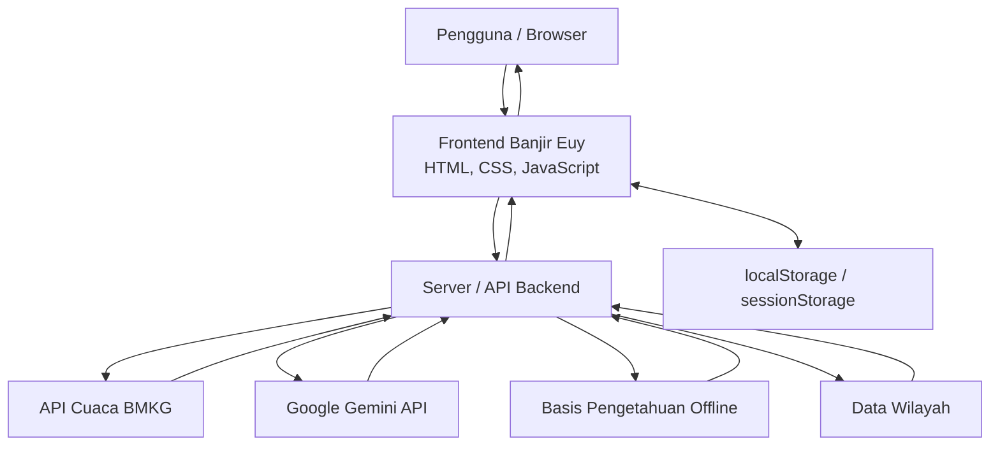

# Banjir Euy 🌧️
### Edukasi Interaktif Kesiapsiagaan Banjir untuk Siswa SMA/SMK/Sederajat

**Banjir Euy** merupakan aplikasi edukasi berbasis web yang dirancang untuk meningkatkan pengetahuan dan kesiapsiagaan siswa SMA/SMK/sederajat dalam menghadapi bencana banjir. Aplikasi ini menggabungkan materi edukasi interaktif, simulasi pengambilan keputusan, kuis, checklist tas siaga, chatbot AI, serta informasi prakiraan cuaca dari BMKG.

> **LOGICODIX 2026 — Hackathon Competition**  
> Kategori: Web  
> Subtema: Smart & Fun Education

---

# 1. Identitas Tim

**Nama Tim:** Gass Aja

| Nama Anggota | Program Studi | Akun GitHub |
|---|---|---|
| Anceli Anggi Putri Br Sidabalok | Meteorologi, ITB | [@anggiancely-droid](https://github.com/anggiancely-droid) |
| Bulan Ayu Azzahra | Meteorologi, ITB | [@bulanazzahrasn-afk](https://github.com/bulanazzahrasn-afk) |
| Arzhella Alvyana Alcaf | Meteorologi, ITB | [@arzhellaalyanaalcaf-byte](https://github.com/arzhellaalyanaalcaf-byte) |
| Yuriko Zulaikha Alhaz | Meteorologi, ITB | [@yurikoalhaz-07](https://github.com/yurikoalhaz-07) |

---

# 2. Deskripsi Solusi

## 2.1 Latar Belakang Permasalahan

Banjir merupakan salah satu bencana hidrometeorologi yang dapat mengganggu aktivitas masyarakat, termasuk kegiatan pendidikan. Siswa yang tinggal atau bersekolah di wilayah rawan banjir berpotensi menghadapi berbagai risiko, seperti terhambatnya perjalanan menuju sekolah, genangan di lingkungan sekitar, hingga kurangnya pemahaman mengenai tindakan keselamatan sebelum, saat, dan setelah banjir.

Informasi mengenai cuaca dan kesiapsiagaan bencana sebenarnya telah tersedia melalui lembaga resmi seperti Badan Meteorologi, Klimatologi, dan Geofisika (BMKG) serta Badan Nasional Penanggulangan Bencana (BNPB). Namun, informasi tersebut perlu disampaikan melalui media yang lebih interaktif dan mudah dipahami oleh pelajar.

## 2.2 Solusi yang Ditawarkan

Banjir Euy dikembangkan sebagai media pembelajaran digital yang menggabungkan edukasi kebencanaan dengan teknologi interaktif.

Pengguna diajak mengikuti tahapan pembelajaran:

**Pahami → Siapkan → Latihan → Uji Diri → Beraksi**

Melalui tahapan tersebut, siswa dapat mempelajari penyebab dan dampak banjir, memahami langkah kesiapsiagaan, berlatih menghadapi skenario banjir, menguji pemahaman melalui kuis, serta menerapkan tindakan kesiapsiagaan dalam kehidupan sehari-hari.

Banjir Euy juga menyediakan dashboard cuaca berbasis data prakiraan BMKG dan chatbot AI untuk membantu pengguna memahami informasi cuaca serta materi kesiapsiagaan banjir.

## 2.3 Target Pengguna

Target utama aplikasi adalah siswa SMA/SMK/sederajat, khususnya pelajar berusia sekitar 15–18 tahun yang tinggal atau bersekolah di wilayah yang berpotensi mengalami banjir.

## 2.4 Tujuan Pengembangan

1. Meningkatkan pengetahuan siswa mengenai banjir dan faktor penyebabnya.
2. Memberikan pemahaman mengenai tindakan kesiapsiagaan sebelum, saat, dan setelah banjir.
3. Melatih kemampuan siswa dalam mengambil keputusan melalui simulasi interaktif.
4. Membantu siswa memahami informasi prakiraan cuaca BMKG.
5. Mendorong penerapan perilaku siaga bencana dalam lingkungan sekolah dan kehidupan sehari-hari.

---

# 3. Fitur Utama Aplikasi

Berikut merupakan fitur utama yang dikembangkan dalam Banjir Euy.

| Fitur | Deskripsi |
|---|---|
| Landing Page | Halaman pengenalan aplikasi dengan ilustrasi dan animasi bertema banjir. |
| Beranda Siswa | Menampilkan progres belajar, informasi cuaca, kartu fitur, dan pencapaian pengguna. |
| Edukasi Banjir | Menyediakan tujuh materi mengenai banjir, penyebab, dampak, tindakan sebelum, saat, dan setelah banjir, serta cara membaca informasi cuaca. |
| Starter Pack | Checklist 14 perlengkapan tas siaga bencana yang dapat disimpan dan diunduh dalam format PDF. |
| Simulasi Banjir | Lima skenario interaktif mengenai pengambilan keputusan ketika menghadapi kondisi banjir di lingkungan sekolah. |
| Kuis | Sepuluh soal evaluasi dengan skor dan pembahasan jawaban. |
| Hasil dan Pencapaian | Menampilkan hasil belajar, statistik, serta enam lencana pencapaian. |
| Aksi Nyata | Menyediakan ajakan dan rencana tindakan untuk meningkatkan kesiapsiagaan banjir di lingkungan sekolah. |
| Pencarian Lokasi | Memungkinkan pengguna mencari wilayah berdasarkan nama atau memilih wilayah secara bertingkat dari provinsi hingga kelurahan/desa. |
| Dashboard Cuaca BMKG | Menampilkan informasi kondisi cuaca dan prakiraan berdasarkan wilayah yang dipilih pengguna. |
| Chatbot AI Kak Euy | Membantu menjawab pertanyaan seputar banjir, kesiapsiagaan, dan informasi cuaca. |
| Notifikasi | Menyediakan ringkasan informasi cuaca dan pengingat progres belajar. |
| Desain Responsif | Mendukung penggunaan pada perangkat desktop maupun mobile serta menyediakan dukungan navigasi keyboard dan pengurangan animasi. |

---

# 4. Teknologi yang Digunakan

| Komponen | Teknologi | Kegunaan |
|---|---|---|
| Frontend | HTML5 | Struktur halaman aplikasi. |
| Styling | CSS3 | Desain antarmuka, animasi, dan responsivitas. |
| Frontend Logic | JavaScript ES Modules | Pengelolaan interaksi, navigasi, dan fitur aplikasi. |
| Backend | Node.js | Menjalankan server lokal dan menangani permintaan API. |
| API Cuaca | API Prakiraan Cuaca Publik BMKG | Mengambil informasi prakiraan cuaca. |
| Artificial Intelligence | Google Gemini API | Menjalankan chatbot AI Kak Euy. |
| Alternatif AI | OpenAI-compatible API | Alternatif penyedia layanan AI jika dikonfigurasi. |
| Penyimpanan Lokal | localStorage | Menyimpan progres pembelajaran dan preferensi pengguna. |
| Penyimpanan Sesi | sessionStorage | Menyimpan riwayat percakapan chatbot pada sesi browser. |
| Visualisasi | SVG, CSS Animation, Canvas | Menghasilkan ilustrasi, ikon, dan animasi antarmuka. |
| Deployment | Vercel | Menyediakan opsi deployment aplikasi web dan fungsi API. |

Aplikasi menggunakan JavaScript ES Modules tanpa framework frontend dan tidak memerlukan proses build khusus. Server lokal menggunakan modul bawaan Node.js sehingga tidak memerlukan dependensi npm tambahan berdasarkan konfigurasi proyek.

---

# 5. Arsitektur Sistem dan Alur Data

## 5.1 Diagram Arsitektur



## 5.2 Penjelasan Alur Sistem

1. Pengguna membuka aplikasi melalui browser.
2. Frontend memuat halaman dan fitur aplikasi dari direktori `public/`.
3. Pengguna dapat memilih wilayah melalui fitur pencarian atau pemilihan wilayah bertingkat.
4. Frontend mengirimkan permintaan ke endpoint `/api/cuaca` untuk memperoleh informasi prakiraan cuaca dari BMKG.
5. Backend memproses dan menyesuaikan data cuaca sebelum dikirimkan kembali ke frontend.
6. Ketika pengguna menggunakan chatbot Kak Euy, pesan dikirimkan ke endpoint `/api/chat`.
7. Backend meneruskan permintaan ke layanan AI menggunakan API key yang disimpan sebagai environment variable.
8. Jika layanan AI tidak tersedia atau API key tidak dikonfigurasi, chatbot dapat menggunakan basis pengetahuan lokal sesuai implementasinya.
9. Progres belajar disimpan pada penyimpanan lokal browser sehingga tidak memerlukan akun pengguna.

## 5.3 Keamanan Sistem

- API key disimpan pada environment variable dan tidak ditulis langsung pada kode frontend.
- File `.env` dimasukkan ke `.gitignore` agar tidak ikut diunggah ke repository.
- Repository menyediakan `.env.example` sebagai contoh konfigurasi tanpa nilai kredensial asli.
- Backend menerapkan pembatasan permintaan pada layanan chatbot sesuai implementasi aplikasi.
- Data progres belajar disimpan secara lokal pada browser pengguna.

---

# 6. Panduan Instalasi dan Menjalankan Aplikasi

## 6.1 Persyaratan Sistem

Sebelum menjalankan aplikasi, pastikan perangkat telah memiliki:

- Node.js versi 18 atau lebih baru.
- Browser modern seperti Google Chrome, Microsoft Edge, atau Mozilla Firefox.
- Koneksi internet untuk mengakses layanan API eksternal.
- Git untuk mengambil source code dari repository (opsional jika source code sudah tersedia).

## 6.2 Mengambil Source Code

Clone repository menggunakan perintah berikut:

```bash
git clone https://github.com/arzhellaalyanaalcaf-byte/logicodix2026-gass-aja.git
```

Masuk ke direktori proyek:

```bash
cd logicodix2026-gass-aja
```

## 6.3 Konfigurasi Environment Variable

Salin file `.env.example` menjadi `.env`.

Untuk Windows:

```powershell
copy .env.example .env
```

Untuk Linux/macOS:

```bash
cp .env.example .env
```

Buka file `.env`, kemudian isi konfigurasi layanan AI jika ingin menggunakan chatbot berbasis AI.

Contoh:

```env
PORT=3000

GEMINI_API_KEY=MASUKKAN_API_KEY_ANDA
GEMINI_MODEL=gemini-flash-lite-latest

OPENAI_API_KEY=
OPENAI_BASE_URL=
OPENAI_MODEL=
```

API key dapat diperoleh melalui Google AI Studio:

https://aistudio.google.com/apikey

**Penting:** Jangan mengunggah file `.env` ke GitHub. Gunakan `.env.example` untuk membagikan format konfigurasi.

## 6.4 Menjalankan Aplikasi

Jalankan perintah:

```bash
npm start
```

Jika server berhasil berjalan, buka browser dan akses:

```text
http://localhost:3000
```

Aplikasi perlu dijalankan melalui server agar fungsi backend dan integrasi API dapat digunakan. Jangan membuka `public/index.html` secara langsung melalui klik ganda.

## 6.5 Mode Offline Chatbot

Apabila API key tidak tersedia atau layanan AI tidak dapat digunakan, chatbot dapat beralih ke mode offline berdasarkan basis pengetahuan lokal yang disediakan aplikasi.

## 6.6 Deployment ke Vercel

Konfigurasi deployment perlu mengikuti struktur direktori dan konfigurasi Vercel yang digunakan oleh proyek.

Langkah umum:

1. Masuk ke Vercel.
2. Pilih **Add New Project**.
3. Impor repository GitHub Banjir Euy.
4. Periksa konfigurasi framework dan output directory sesuai struktur proyek.
5. Tambahkan environment variable yang dibutuhkan, seperti `GEMINI_API_KEY`.
6. Jalankan deployment.
7. Uji seluruh fitur aplikasi melalui URL deployment.

---

# 7. Akun Demonstrasi

Banjir Euy tidak mewajibkan pengguna membuat akun atau melakukan autentikasi.

Fitur masuk hanya meminta nama panggilan secara opsional. Informasi tersebut disimpan pada perangkat pengguna melalui browser.

Dengan demikian, tidak terdapat username dan password demonstrasi khusus yang diperlukan untuk mengakses fitur utama aplikasi.

---

# 8. Dokumentasi Penggunaan Artificial Intelligence

## 8.1 Integrasi AI pada Produk

| Layanan AI | Penggunaan | Implementasi |
|---|---|---|
| Google Gemini API | Menjawab pertanyaan pengguna mengenai banjir, kesiapsiagaan, dan interpretasi informasi cuaca. | Chatbot AI Kak Euy melalui `api/chat.js`. |
| Basis Pengetahuan Offline | Menyediakan jawaban alternatif ketika layanan AI tidak tersedia atau tidak dikonfigurasi. | `api/_offline.js`. |

Chatbot Kak Euy menerima pesan pengguna dan dapat menggunakan ringkasan informasi cuaca yang sedang dilihat pengguna sebagai konteks percakapan.

## 8.2 Penggunaan AI dalam Proses Pengembangan

ChatGPT (OpenAI) digunakan sebagai alat bantu dalam proses pengembangan proyek, terutama untuk:

- Diskusi ide dan penyusunan struktur aplikasi.
- Bantuan memahami dan memperbaiki kesalahan kode.
- Penyusunan dokumentasi teknis.
- Penyempurnaan penjelasan fitur dan alur penggunaan aplikasi.

Seluruh hasil bantuan AI ditinjau dan disesuaikan oleh anggota tim sebelum digunakan dalam proyek.

**Catatan:** Dokumentasikan juga layanan AI lain yang benar-benar digunakan oleh anggota tim selama pengembangan, apabila ada.

## 8.3 Etika dan Keamanan Penggunaan AI

- Chatbot diarahkan untuk mengutamakan informasi keselamatan dan kesiapsiagaan bencana.
- Informasi cuaca merujuk pada data yang diperoleh dari sumber BMKG.
- API key tidak disimpan langsung di frontend.
- Chatbot memiliki mekanisme pembatasan permintaan sesuai implementasi backend.
- Pengguna diberikan pemahaman bahwa jawaban AI dapat memiliki keterbatasan dan tidak menggantikan instruksi resmi dari petugas berwenang.

---

# 9. Atribusi Sumber, Data, dan Aset

## 9.1 Sumber Data dan Informasi

| Sumber | Penggunaan |
|---|---|
| Badan Meteorologi, Klimatologi, dan Geofisika (BMKG) | Data prakiraan cuaca dan informasi meteorologi. |
| Badan Nasional Penanggulangan Bencana (BNPB) | Referensi edukasi kebencanaan dan kesiapsiagaan banjir. |
| Kemendagri melalui dataset `idn-area-data` | Referensi kode wilayah administratif Indonesia. |

Tautan sumber:

- BMKG: https://data.bmkg.go.id/prakiraan-cuaca/
- BNPB: https://www.bnpb.go.id/
- Dataset wilayah: https://github.com/fityannugroho/idn-area-data

## 9.2 Atribusi Foto

Foto yang digunakan dalam materi aplikasi merujuk pada sumber berikut sesuai dokumentasi proyek:

- Genangan: VOA Indonesian Service — [People walk through Jakarta's flooded streets](https://commons.wikimedia.org/wiki/File:VOA_People_walk_through_Jakarta%27s_flooded_streets.jpg).
- Luapan sungai: BNPB — [Flood in Tanah Laut Regency](https://commons.wikimedia.org/wiki/File:Flood_in_Tanah_Laut_Regency.jpg).
- Banjir bandang: BNPB — [Banjir Bandang Luwu 2020](https://commons.wikimedia.org/wiki/File:Banjir_Bandang_Luwu_2020.png).
- Banjir rob: Tim LindungiHutan — [Rumah Mak Jah di Desa Bedono](https://commons.wikimedia.org/wiki/File:Rumah_Mak_Jah_di_Desa_Bedono_yang_Tenggelam_karena_abrasi.jpg).

Lisensi dan ketentuan penggunaan setiap foto perlu mengikuti informasi yang tercantum pada halaman sumber aslinya.

## 9.3 Atribusi Ilustrasi dan Elemen Visual

- Ilustrasi vektor berupa sekolah, awan, hujan, gelombang, serta ikon cuaca dibuat menggunakan SVG sesuai aset yang dikembangkan tim.
- **Ilustrasi karakter siswa dan tas:** cantumkan sumber asli dan lisensi aset yang digunakan sebelum submission. Jika dibuat sendiri oleh tim, nyatakan sebagai karya tim. Jika berasal dari pihak ketiga, cantumkan sumber dan lisensinya.

## 9.4 Atribusi Font

Font Plus Jakarta Sans digunakan dalam antarmuka aplikasi. Font ini didistribusikan melalui Google Fonts dengan lisensi SIL Open Font License.

Tautan: https://fonts.google.com/specimen/Plus+Jakarta+Sans

---

# 10. Struktur Folder Proyek

```text
banjireuy/
│
├── api/
│   ├── cuaca.js
│   ├── chat.js
│   ├── wilayah.js
│   ├── _wilayah.js
│   ├── status.js
│   ├── _offline.js
│   └── _util.js
│
├── public/
│   ├── index.html
│   │
│   ├── css/
│   │   └── style.css
│   │
│   ├── assets/
│   │   └── img/
│   │
│   └── js/
│       ├── app.js
│       ├── store.js
│       ├── weather.js
│       ├── ui.js
│       │
│       ├── data/
│       │   └── content.js
│       │
│       ├── components/
│       │   ├── icons.js
│       │   ├── illus.js
│       │   ├── chatbot.js
│       │   ├── pdf.js
│       │   └── confetti.js
│       │
│       └── pages/
│           ├── landing.js
│           ├── beranda.js
│           ├── edukasi.js
│           ├── starter.js
│           ├── simulasi.js
│           ├── kuis.js
│           ├── hasil.js
│           ├── aksi.js
│           └── cuaca.js
│
├── server.js
├── package.json
├── package-lock.json
├── .env.example
├── .gitignore
└── README.md
```

---

# 11. Penutup

Banjir Euy dikembangkan sebagai media edukasi digital yang membantu siswa memahami risiko banjir, meningkatkan kesiapsiagaan, serta melatih kemampuan mengambil keputusan melalui pembelajaran interaktif.

Dengan menggabungkan edukasi kebencanaan, simulasi, evaluasi pembelajaran, informasi cuaca BMKG, dan dukungan chatbot AI, Banjir Euy diharapkan dapat menjadi salah satu sarana pembelajaran kesiapsiagaan banjir yang mudah diakses dan relevan bagi pelajar.

**Banjir Euy — Kenali Risikonya, Siapkan Dirimu, Hadapi dengan Ilmu!**